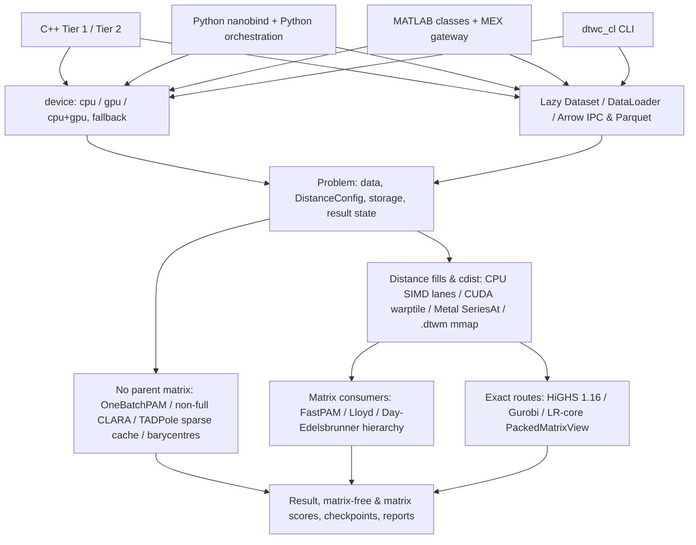

# Architecture

The language surfaces converge on one C++ core. Device and method validation
happen before expensive work; algorithms write their result back into `Problem`,
so Tier-1 results and Tier-2 scores observe the same state. `dtwc_cl`, C++
`dtwc::cluster`, Python `dtwcpp.cluster` and MATLAB `dtwc.cluster` are one C++
function, `dtwc::run`: the same checks, memory plan, loading decision, dispatch
and run report, whichever language calls it.

The important scaling decision is the branch after `Problem`: changing file
format (such as memory-mapped Arrow IPC) reduces ingestion cost, while choosing an algorithm that holds no full $N \times N$ distance matrix (OneBatchPAM, non-full FastCLARA, or `barycenter_kmeans`, plus matrix-free `davies_bouldin` / `inertia` scoring) avoids quadratic distance storage altogether.
